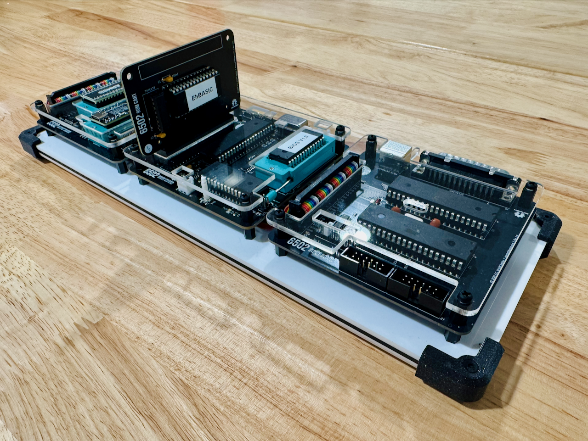

6502-VCS
========

An **AC6502** retro-style 8-bit computer based on the **65C02** microprocessor.

> 📖 **Guide:** [AC6502 Documentation](https://acwright.github.io/6502-DOCS/) — the user's and programmer's guide for the whole family.
> See [VCS's page in the family appendix](https://acwright.github.io/6502-DOCS/family/vcs).

---

**Building one? Every part you need, with supplier numbers and known issues, is in [BOM.md](BOM.md).**

## Table of Contents

- [Overview](#overview)
- [Architecture](#architecture)
- [Systems](#systems)
- [Software](#software)
- [Hardware](#hardware)
  - [Main Board](#main-board)
  - [Input Board](#input-board)
  - [Output Board](#output-board)
  - [ROM Cart](#rom-cart)
  - [Flash Cart](#flash-cart)
  - [Flash Helper](#flash-helper)
- [Which revision to make](#which-revision-to-make)
- [Firmware](#firmware)
  - [IB Controller](#ib-controller)
- [CAD](#cad)
- [Production](#production)
- [Schematics](#schematics)
- [Shared lines](#shared-lines)
- [Extra pins: `EXP0`–`EXP3` and `HRDB`](#extra-pins-exp0exp3-and-hrdb)
- [Jumpers](#jumpers)
- [Off-board headers](#off-board-headers)
- [Libraries](#libraries)
- [Bill of Materials](#bill-of-materials)
- [License](#license)

---

## Overview

The AC6502 ecosystem is a family of open-source, 65C02-based computers sharing a common architecture, memory map, and [BIOS](https://github.com/acwright/6502-BIOS). Each computer in the family is purpose-built for a different use case but runs the same software and firmware.

The **VCS** is a cartridge-based retro gaming console. It features a real 65C02 CPU, swappable ROM cartridges, VGA video output via [Pico9918](https://github.com/visrealm/pico9918), SID audio via ARMSID, and support for PS/2 keyboards, matrix keyboards, and Atari 2600-compatible joysticks.

## Architecture

All AC6502 computers share:

- **CPU**: 65C02 (or accurate emulation)
- **Memory**: 32KB RAM + 32KB ROM, with optional banked RAM expansion
- **Memory Map**: Standardized across the ecosystem — zero page, stack, I/O space ($8000–$9FFF), system ROM, and interrupt vectors at $FFFA–$FFFF
- **Bus**: 16-bit address bus, 8-bit bidirectional data bus, standard 65C02 control signals (RW, PHI2, RESET, IRQ, NMI, RDY, SYNC)
- **BIOS**: A common [BIOS](https://github.com/acwright/6502-BIOS) provides the kernel, monitor, and BASIC interpreter across all systems

## Systems

| Project | Description |
|---------|-------------|
| [6502-ACE](https://github.com/acwright/6502-ACE) | All-in-one Computer Experience — A single board computer |
| [6502-COB](https://github.com/acwright/6502-COB) | Computer On a Backplane — Modular desktop computer with expandable card slots |
| [6502-DEV](https://github.com/acwright/6502-DEV) | Development Environment Vehicle — Emulation-based dev system |
| [6502-KIM](https://github.com/acwright/6502-KIM) | Keypad Input Monitor - KIM-1 inspired minimal computer |
| [6502-VCS](https://github.com/acwright/6502-VCS) | Video Computer System — Cartridge-based retro gaming console (YOU ARE HERE) |

## Software

| Project | Description |
|---------|-------------|
| [6502-BIOS](https://github.com/acwright/6502-BIOS) | The shared BIOS (kernel, monitor, BASIC) for all AC6502 computers |
| [6502-EMULATOR](https://github.com/acwright/6502-EMULATOR) | Emulator for the whole family — desktop app, browser build, and a command line for scripted runs |
| [6502-PRG](https://github.com/acwright/6502-PRG) | Template project for writing assembly language programs |
| [6502-CRT](https://github.com/acwright/6502-CRT) | Template project for writing assembly language cartridges |
| [6502-ASM](https://github.com/acwright/6502-ASM) | Assembly language example programs and demos |
| [6502-BAS](https://github.com/acwright/6502-BAS) | BASIC program listings |
| [6502-WOZMON](https://github.com/acwright/6502-WOZMON) | Wozmon as a standalone ROM |
| [6502-NOP](https://github.com/acwright/6502-NOP) | An all-NOP ROM, for probing a board during bring-up |
| [6502-DOCS](https://github.com/acwright/6502-DOCS) | The documentation site — the guide, the printable reference cards, branding and label artwork |
| [cffs](https://github.com/acwright/cffs) | Builds CompactFlash disk images for the BIOS filesystem |
| [bastok](https://github.com/acwright/bastok) | Tokenizes BASIC listings into `.prg` images, and back |
| [bin2woz](https://github.com/acwright/bin2woz) | Converts a binary into a Wozmon serial upload |

## Hardware

This repository contains KiCad 7.0+ PCB designs for the boards that make up the VCS system.

### Main Board
`Hardware/Main Board/`

The core board containing the 65C02 CPU, 32KB SRAM, 32KB EEPROM, clock, and reset circuitry. Runs at 1 MHz and provides the bus connection for the Input and Output boards.

### Input Board
`Hardware/Input Board/`

Unified input board supporting a matrix keyboard, PS/2 keyboard, and Atari 2600-compatible joysticks. Uses a 65C22 VIA and an ATmega1284 microcontroller as the keyboard encoder controller.

The joysticks share the VIA ports with the keyboard encoder rather than having connectors of their own: they come in on the `J1` PORT B and `J2` PORT A box headers, with `JOY(1)` reading PORT B and `JOY(2)` reading PORT A. See [Joystick Interface](./Firmware/IB%20Controller/README.md#joystick-interface) for the wiring options and the bitmask the BIOS returns.

### Output Board
`Hardware/Output Board/`

Combined VGA video output (via Raspberry Pi Pico running [Pico9918](https://github.com/visrealm/pico9918)) and SID audio output (via ARMSID). Provides TMS9918A-compatible graphics modes at 640×480 VGA and 3-voice SID synthesis.

### ROM Cart
`Hardware/ROM Cart/`

Swappable ROM cartridge for the VCS system. Comes in two versions:

- **Rev 1.0a** — Uses the **28C256** 32KB EEPROM (electrically erasable, no UV eraser required).
- **Rev 1.0b** — Uses the **27C256** 32KB EPROM (UV-erasable).

### Flash Cart
`Hardware/Flash Cart/`

Banked flash cartridge, and the successor to the fixed 16K ROM Cart. One all-SMD board covers 128KB to 1MB,
depending on which parts are populated, and the flash is programmed in circuit through the card edge, either by
the Flash Helper (an Arduino Mega 2560 shield with one connector on it) or by the 6502 itself.

- `$C000–$DFFF` is a switchable 8K window, selected by a write-only bank register at `$E000–$FFFF`.
- `$E000–$FFFF` is fixed to the last 8K of the primary flash, so the vectors and the bank-switching code can
  never be mapped out.
- Existing 16K cart images run unmodified.
- **Tested in the 512KB and 1MB builds** (2026-11-09): programmed through the Flash Helper, and run on an ACE,
  banking into both chips and saving across a power cycle. The 128KB and 256KB builds (SST39SF010A, SST39SF020A)
  use the same board but haven't been built yet.
- Its 0.5 mm TSOP parts make it the hardest board in the family to build by hand: having JLCPCB assemble it is the
  preferred way to get one. See the build notes in [BOM.md](BOM.md#build-notes).

See [DESIGN.md](./Hardware/Flash%20Cart/Rev%201.0/DESIGN.md) for the memory map, the logic, the programming
sequences and the build variants.

### Flash Helper
`Hardware/Flash Helper/`

The programmer for the Flash Cart: an Arduino Mega 2560 R3 shield with a cartridge slot on it, and
nothing else. It pretends to be the 65C02 on the far side of the card edge, so a cart is programmed
in circuit with no chip ever removed — which matters, because the flash is a soldered-down TSOP part.

- Two parts: the Arduino, and the same TE card edge connector the Main Board fits as J9.
- Thirty-seven of the forty card edge pins: `A0–A15`, `D0–D7`, `RWB`, `PHI2`, `RESB`, `IRQB`, `NMIB`,
  `VCC` and `GND`.
- `EXP0` and `EXP1` are deliberately **not** connected. Cartridges tie them to GND to disable the
  system ROM, so driving them would be a short.
- Host side is `6502-flash`, a Node CLI. See [DESIGN.md](./Hardware/Flash%20Cart/Rev%201.0/DESIGN.md).

**As a card tester.** Every card in the AC6502 family — the [COB](https://github.com/acwright/6502-COB)
cards, the [KIM](https://github.com/acwright/6502-KIM) Keypad Card and both VCS carts — carries the same
`6502 Card Edge` fingers and drops into this socket. `IRQB` and `NMIB` are wired for that reason rather
than for programming: the GPIO, LCD, Serial and Serial Card Pro cards all assert `IRQB`, and a tester
that could not see it would miss most of what they do. That firmware is a separate build and does not
exist yet.

<!-- Which revision to make: generated by Tools/revision-audit/register.py from Tools/data/orders.json. Edit that file, not this section. -->
## Which revision to make

**Make the newest revision of a board, and check its label first.** The table below gives each board's newest revision. A newer revision fixes what was found on the older ones. Every revision, old and new, is in [REVISIONS.md](REVISIONS.md), with what changed in each.

Each revision carries one of three labels:

- **Tested:** This revision was built and tested.
- **Proven design:** Not built at this revision, but its circuit is a tested revision's. The only changes are silkscreen text, part values, mounting holes, outline clean-up, capacitor pitch, socket outlines, a footprint swap with the same holes, a solder jumper's default, the solder mask or paste at a card edge, or tracks rerouted or pours refilled with DRC and the netlist check passing. A builder can treat it as tested.
- **Untested:** The circuit, the power path or the layout changed in a way that only a built board proves, or the board has never been built at all.

[BOM.md](BOM.md) has the parts for every revision, and its known issues.

| Board | Newest revision | Label | Why |
|---|---|---|---|
| Flash Cart | 1.1 | **Proven design** | The bare card edge and the shell's holes at their nominal places. |
| Flash Helper | 1.0 | **Tested** | Built and tested. |
| Input Board | 1.1 | **Proven design** | Silkscreen text only. |
| Main Board | 1.1 | **Proven design** | 10k pull-ups, small part moves and tracks rerouted. The jumpers are gone, and `HRDB` is wired as it is on the tested Rev 1.0 with them fitted. |
| Output Board | 1.1 | **Proven design** | Silkscreen text, the `VDD` header removed, JP1 ships open, and JP2 and JP3 removed and wired as Rev 1.0 ships them. |
| ROM Cart | 1.1 | **Proven design** | The bare card edge and the shell's holes at their nominal places; it takes the AT28C256, as Rev 1.0a does. |
<!-- End of which revision to make -->

## Firmware

This repository contains [PlatformIO](https://platformio.org/)-based firmware for the Input Board.

### IB Controller
`Firmware/IB Controller/`

Firmware for the ATmega1284 on the Input Board. Provides:

- Matrix keyboard scanning and encoding
- PS/2 keyboard interface
- Atari 2600-compatible joystick input
- Parallel I/O to the AC6502 bus via 65C22 VIA

See [Firmware/IB Controller/README.md](./Firmware/IB%20Controller/README.md) for setup and usage instructions.

## CAD
`CAD/`

3D-printable enclosure parts and laser-cut top panels for the VCS system.

**Board images** are in `CAD/Images/<Board>/Rev X/`: `Front.png` and `Back.png` on white, and `Front Transparent.png` and `Back Transparent.png` with no background. Every image is a 3D render at the same size, with the black solder mask and white silkscreen the boards are made with. Bare-board photos may differ, because the renders show parts fitted.

**Top panels are versioned by board revision**, like `Hardware/`: `CAD/Tops/<Board>/Rev X/`. Each revision has its own complete folder, even when two revisions share the same files. `Bases/` holds the parts for a whole computer, not for one board, so it isn't versioned.

The **[plate mounting drawing](CAD/Bases/Plate%20Mounting%20Drawing.png)** ([SVG](CAD/Bases/Plate%20Mounting%20Drawing.svg)) shows where the Output Board, the Main Board and the Input Board mount on the base plate, with every hole's position and the hardware the build needs. The plate is a stack of three 3 mm acrylic layers.

## Production
`Production/`

[REVISIONS.md](REVISIONS.md) lists every board revision: whether it was made, its JLCPCB order, the commit it was made from, and what fits it.

JLCPCB-ready Gerber files and BOM/CPL for PCB fabrication and assembly.

## Schematics
`Schematics/`

PDF schematics for each board.

## Shared lines

Five lines of the 6502 bus are shared by every board on it: `RESB`, `IRQB`, `NMIB`, `RDY` and `BE`. A board may pull one of these lines low, and nothing drives one high. Each line is held high by one 10kΩ pull-up resistor to VCC, on the board with the CPU: the ACE Board, the KIM Board, the VCS Main Board, the COB CPU Card or CPU Card Pro, or the DEV Board. No other board has one. Two pull-ups on the same line would sit in parallel and lower its resistance, so a card that adds its own pull-up changes the machine for every other board. The VIAs and PIAs in the BOMs, the W65C22N and W65C21N, have open-drain interrupt outputs for this reason.

**Interrupt outputs.** Whatever drives `IRQB` or `NMIB` may only pull it low. Every board is drawn for the parts in its BOM and works as shipped, with no jumper to cut or bridge:

- **A part whose interrupt output is open-drain** (the W65C22N, W65C21N, R6551AP, DS1511Y and TMS9918A) drives the line directly, or through a diode with a solder jumper across it that ships bridged. The diode is fitted either way. To use a part that drives its interrupt high as well as low instead, such as a W65C22S or a replacement of your own, cut the jumper: the diode then lets the part only pull the line low. A board with no diode in the line can't take such a part.
- **A part that drives its interrupt high as well as low** (the pico9918, the VERA module, and a microcontroller such as the ATmega1284 or a Raspberry Pi Pico) reaches the line through a diode, a BAT85 or a 1N914, with its cathode toward the part. Where a solder jumper sits across that diode, it ships open. The diode is then the only path to the line, so fit it, and never bridge the jumper, because the part would then hold the line high against every other interrupt source.
- **A microcontroller wired to the line directly,** as on the ACE Board, the Mega Helper and the Flash Helper, drives it open-drain in its firmware: it sets the pin low or leaves it as an input, and never drives it high.

The *Jumpers* section below gives each board's interrupt jumper.

The same holds where a board has its own reset circuit. A reset switch, its timer and the transistor that pulls `RESB` low can be on any board, such as the COB Backplane Pro or the Clock Card, but the `RESB` pull-up is only ever on the board with the CPU. Each of those boards draws its pull-ups together, in one group on its schematic.

`SOB` is a CPU pin that isn't on the bus. It is tied to VCC, directly or through a 10kΩ resistor.

A few chips have a pull-up of their own inside the chip, such as an ATmega's reset pin. Where such a pin is wired to `RESB`, its pull-up of 30–60kΩ sits in parallel with the 10kΩ one. That's harmless, because whatever pulls `RESB` low can sink the extra current many times over.

A revision that doesn't follow this yet says so in its known issues in [BOM.md](BOM.md), with what to fit or remove.

## Extra pins: `EXP0`–`EXP3` and `HRDB`

`EXP` stands for "extra pin". Four pins of the 6502 bus are left for a builder's own use: pin 4 is `EXP1`, pin 6 is `EXP0`, pin 19 is `EXP3` and pin 21 is `EXP2`.

Pins 4 and 6 have a second job. A cartridge ties both of them to GND. That pulls `HRDB` ("High ROM disable bar", active low) low on the board with the ROM, which takes `$C000–$FFFF` away from the ROM so that the cartridge answers there instead. So in a build that uses cartridges, pins 4 and 6 are reserved for `HRDB`, and nothing else may drive them. They are free as `EXP1` and `EXP0` only in a build that never uses cartridges. `EXP2` and `EXP3` are always free.

How the boards treat pins 4 and 6:

- **The ACE Board and the KIM Board** join them to their ROM's `HRDB` input, and their silk says `HRDB`. The VCS Main Board joins them the same way from Rev 1.1.
- **The COB Memory Card** joins them to its `HRDB` only through jumpers: fit two shunts on J2, or bridge JP1 and JP2, in a COB that takes cartridges. It is the only board with these jumpers, because the COB is the experimenter's build. The VCS Main Board Rev 1.0 had them too (J5, or JP3 and JP4); fit them, because the VCS always takes cartridges.
- **A cartridge** (the ROM Cart, the Flash Cart, the KIM Keypad Card) ties them to GND.
- **A board that only carries the bus through**, such as a backplane or a helper, calls them `EXP1` and `EXP0`, as its silk does, and a note on its schematic says what they carry.

<!-- Jumpers: generated by Tools/jumpers/gen.py from Tools/data/jumpers.json. Edit that file, not this section. -->
## Jumpers

Some boards have solder jumpers, and pin headers that take a shunt. The tables below give every one: what it's for, how the board is shipped, and what to do with it. The **Needed** column marks the ones that matter:

- **To run**: the board doesn't work until this is set. Set it before the first power-up.
- **For serial**, **For interrupts**, **For cartridges**: the board runs without it, but that feature doesn't.
- Blank: leave it as shipped unless you want what it offers.

Where a header needs a shunt, the board's BOM lists it.

**Input Board**

| Rev | Jumper | What it's for | As shipped | What to do | Needed |
|---|---|---|---|---|---|
| 1.0, 1.1 | J6 | I/O window: one shunt picks the 1 KB window the board answers in. | No shunt. | Fit the shunt beside `$9400`: IO 6, where the BIOS looks for the Input Board. | To run |
| 1.0, 1.1 | JP1 | Across D1, the diode in the W65C22N's interrupt line. | Bridged. | Leave it. The W65C22N's interrupt output is open-drain: it only pulls the line low, so the board works as shipped and D1 isn't needed. To fit a part that drives its interrupt high as well as low, such as a W65C22S, cut JP1 so the interrupt goes through D1. |  |

**Main Board**

| Rev | Jumper | What it's for | As shipped | What to do | Needed |
|---|---|---|---|---|---|
| 1.0 | J5, JP3, JP4 | `HRDB EN`: joins the bus's `EXP1` and `EXP0` to the ROM's High ROM disable. | Open, no shunts. | Fit two shunts on J5, or bridge JP3 and JP4: without them a cartridge can't take `$C000–$FFFF`, and the VCS always takes cartridges. Rev 1.1 wires them. | For cartridges |
| 1.0 | J8 | `EXP EN`: shunts here join CPU signals (`VPB`, `MLB`, `SOB`, `PHI1O`, `PHI2O`) to the bus's extra pins. | No shunts. | Leave it empty: the VCS takes cartridges, which ground `EXP0` and `EXP1`. Rev 1.1 has no J8. |  |
| 1.0 | JP1, J2 | `ROM WE`: joins the ROM's `/WE` to the write strobe, so a program can write the EEPROM in circuit. | Open, no shunt. | Leave it open: R1 holds `/WE` high. Rev 1.1 ties `/WE` to VCC. |  |
| 1.0 | JP2, J1 | Power: JP2 is across J1 (`PWR_SW`), the header for a power switch. | Open. | Bridge JP2, or wire a switch to J1. Until one is done the board has no power. Rev 1.1 has neither. | To run |
| 1.0 | JP5, J7 | Original 6502: grounds pin 1, which is `VSS` on an NMOS 6502 and `VPB` on a 65C02. | Open, no shunt. | Leave both open for a 65C02. Rev 1.1 has neither. |  |
| 1.0 | JP6, J6 | Clock: JP6 is across J6 (`CLOCK_ENBL_SW`), the header for a switch that stops the clock. | Open. | Bridge JP6, or wire a switch to J6. Until one is done there is no clock on `PHI2`. Rev 1.1 has neither. | To run |

**Output Board**

| Rev | Jumper | What it's for | As shipped | What to do | Needed |
|---|---|---|---|---|---|
| 1.0, 1.1 | J6 | Interrupt: one shunt sends the board's interrupt to `IRQB` or `NMIB`. | No shunt. | Fit the shunt on `IRQB`, which the BIOS expects. With no shunt the interrupt reaches neither. | For interrupts |
| 1.0, 1.1 | J7 | I/O windows: two shunts pick the windows for the sound chip and the video chip. | No shunts. | Fit one shunt beside `$9800` (IO 7) for the sound chip and one beside `$9C00` (IO 8) for the video chip, where the BIOS looks for them. | To run |
| 1.0 | JP1 | Across D1, the diode in the pico9918's interrupt line. | Bridged. | Cut JP1. The pico9918 drives its interrupt high as well as low, and only D1 stops it holding `IRQB` high against every other interrupt source. Rev 1.1 ships it open. | For interrupts |
| 1.0 | JP3, JP2 | JP3 feeds `PHI2` to an enable of U3, a 74HC138, so the board is selected only while `PHI2` is high. JP2 would tie that enable high instead. | JP3 bridged, JP2 open. | Leave them. With `PHI2` on the decoder's enable, the card's read and write strobes last only while `PHI2` is high, when the 6502's address and data are valid, as the chips need. Tied high, the strobes would run through the whole cycle and glitch while the address settles. Rev 1.1 has no jumpers here: `PHI2` goes straight to the enable. |  |
| 1.1 | JP1 | Across D1, the diode in the pico9918's interrupt line. | Open. | Leave it open. The pico9918 drives its interrupt high as well as low, and D1 lets it only pull `IRQB` low. Bridged, JP1 would let it hold the line high against every other interrupt source. Never bridge it. Fit D1, which the BOM lists: with the jumper open it is the only path to the line, so without it the board never interrupts. |  |

<!-- End of jumpers -->

<!-- Off-board headers: generated by Tools/offboard/gen.py from Tools/offboard/offboard.json, Tools/data/offboard.json and the PCB files. Edit those, not this section. -->
## Off-board headers

Some boards have small headers, such as `RESET SW`, `CLOCK ENBL SW`, `POWER LED` and `VCC`, that a standard build leaves empty. They are for a machine built into a full enclosure, which AC6502 doesn't offer today. In such a build, the parts a person handles are mounted on the case and wired to the board through these headers: the power jack, the switches, the LEDs and the keyboard. The matching parts on the board are then left off. For example, an ACE Board can sit inside a case with its power jack, power switch and key switches left off, and a Keyboard Helper as its keyboard.

To build a board for a case:

1. Fit the header, and wire the part on the case to it. The table says what goes on each pin.
2. Leave off the parts on the board that the table names. A button on the case can work beside the board's own button, but some parts, such as an LED that shares the board's resistor, can't share.
3. Set any jumper the table mentions. The [Jumpers](#jumpers) section has the rest.

The connector follows the kind of build. A single-board machine, the ACE Board or the KIM Board, uses plain 2.54 mm pin headers, which are simpler and cheaper. A board in a multi-board machine, every COB board and the separate boards of the VCS, the DEV and the KIM, uses JST XH, the family's standard for these headers.

The table lists every off-board header on each board's newest revision, read from the board's PCB file.

| Board | Rev | Header | Label | Connector | What it's for | Leave off |
|---|---|---|---|---|---|---|
| Main Board | 1.1 | J4 | `RESET SW` | JST XH, 2 pins | A reset button on the case. The header is wired across SW1, the board's own reset button. | SW1, if the case covers it. Both buttons reset the machine if it stays. |

<!-- End of off-board headers -->

## Libraries
`Libraries/`

Shared KiCad symbol and footprint libraries used across all AC6502 hardware projects, with their 3D models in `Models/`. A part is named for what it is and its shape, such as `RJ45 Jack LED` or `CR2032 Holder`, never for a manufacturer's part number, so a replacement part with the same footprint fits without renaming anything. The part numbers to buy are in [BOM.md](BOM.md). Every AC6502 repository carries the same copy of each part.

## Bill of Materials

Every part for every board, by revision, is in **[BOM.md](BOM.md)**, with supplier numbers, known issues, build notes and files to upload to Digi-Key and Mouser. What changed in each revision, and what is known about each one, is in **[REVISIONS.md](REVISIONS.md)**.

## License

Hardware designs are released under the [CERN Open Hardware Licence Version 2 – Permissive](https://ohwr.org/cern_ohl_p_v2.txt).  
Firmware is released under the [MIT License](./Firmware/IB%20Controller/LICENSE).
